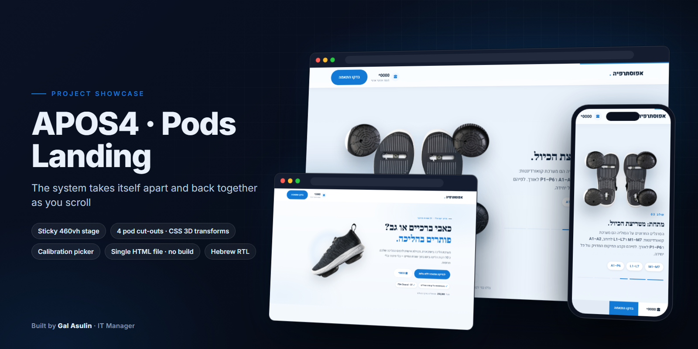
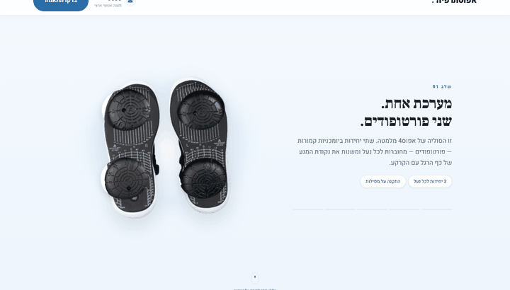
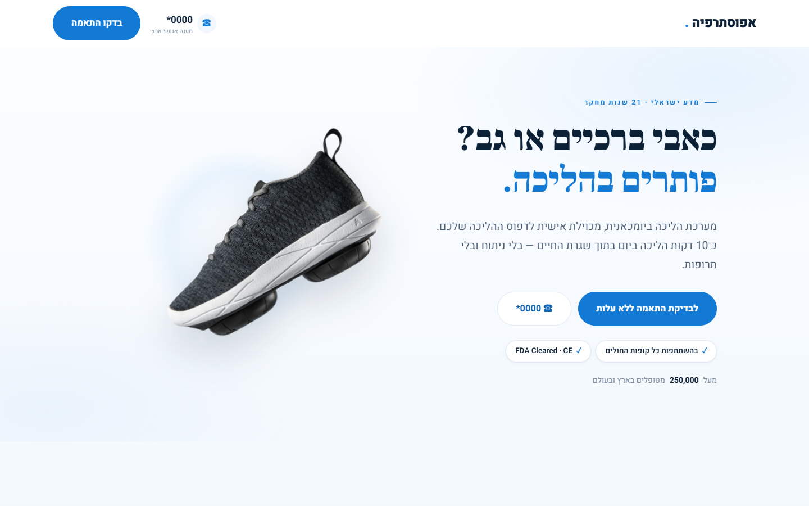
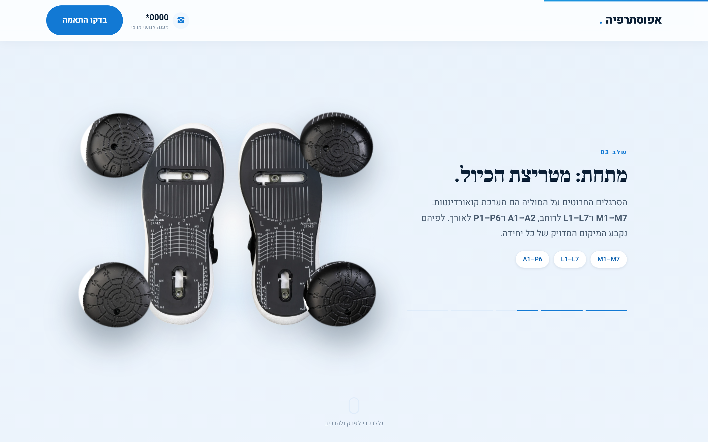
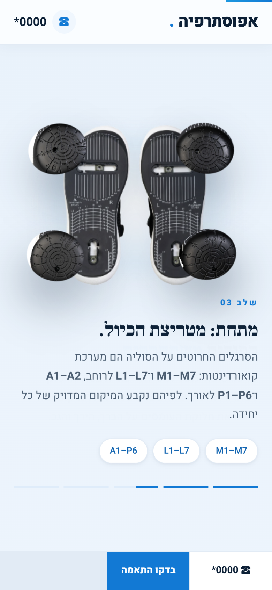
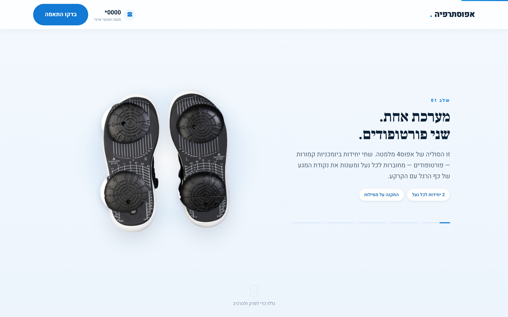
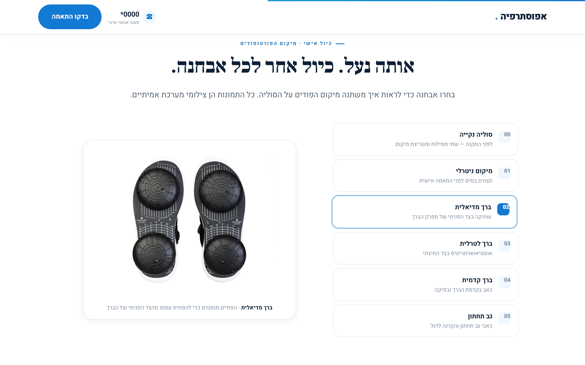
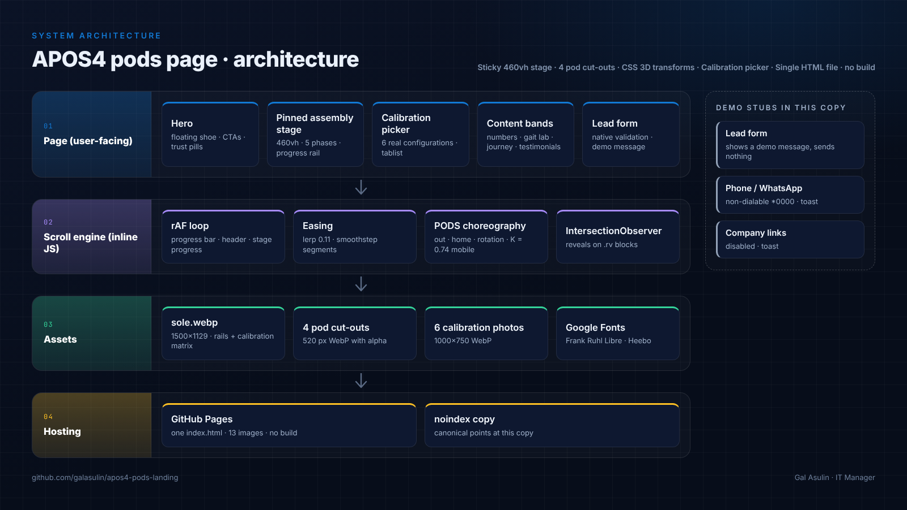
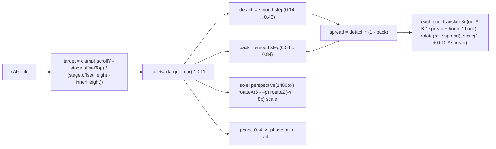

<p align="center"><a href="https://galasulin.github.io/apos4-pods-landing/"></a></p>

<div align="center">

# APOS4 · דף נחיתה עם פירוק הפודים

**דף מוצר שבו מערכת APOS4 מתפרקת ומתחברת מחדש תוך כדי גלילה, מארבעה פודים שנחתכו מצילום המוצר האמיתי ומ-CSS transforms חיים.**

🇬🇧 [English](README.md) · 🇮🇱 עברית

[](https://galasulin.github.io/apos4-pods-landing/)


<br>


[דמו חי](https://galasulin.github.io/apos4-pods-landing/) · [מסכים](#מסכים) · [ארכיטקטורה](#ארכיטקטורה) · [טכני](#פרמטרים-טכניים)

<br>

<a href="https://galasulin.github.io/apos4-pods-landing/"></a>

<sub>בדף החי גוללים דרך הבמה המוצמדת כדי לפרק את המערכת ולהרכיב אותה מחדש.</sub>

</div>

<div dir="rtl" align="right">

> **עותק לתיק עבודות.** עותק סטטי ומנוקה של דף נחיתה שעיצבתי ובניתי לרשת המרפאות. קוד מעקב לא נוסף לגרסה הזו מלכתחילה; הטופס מציג הודעת הדגמה בלבד; הטלפון והוואטסאפ הוחלפו ב-`*0000` שאי אפשר לחייג אליו; הקישורים לאתר החברה מנוטרלים; ושמות המטופלים בהמלצות הוחלפו בשמות בדויים.

## במבט מהיר

| | |
|---|---|
| **סוג** | דף נחיתה למוצר עם אנימציית הרכבה שמונעת מגלילה |
| **סטטוס** | גרסת עבודה שנבנתה להשקת APOS4 · הריפו הזה הוא העותק המנוקה |
| **סטאק** | HTML5 · ‏CSS (sticky, ‏3D transforms, משתני CSS) · JavaScript נקי |
| **התפקיד שלי** | קונספט, הכנת התמונות, עיצוב ופיתוח Front-end |
| **דמו חי** | [galasulin.github.io/apos4-pods-landing](https://galasulin.github.io/apos4-pods-landing/) |
| **שפות** | ממשק בעברית (RTL) · תיעוד באנגלית ובעברית |

## מסכים

<table>
  <tr>
    <td width="33%"><a href="docs/desktop-hero.png"></a><br><sub><b>ראש הדף</b> · נעל מרחפת, קריאה לפעולה ותגיות אמון</sub></td>
    <td width="33%"><a href="docs/stage-apart.png"></a><br><sub><b>הבמה · מפורק</b> · שלב 03, הפודים מנותקים לגמרי, המסילות ומטריצת הכיול גלויות</sub></td>
    <td width="33%" align="center"><a href="docs/mobile-stage.png"></a><br><sub><b>מובייל</b> · הסוליה למעלה, טקסט השלב מתחת</sub></td>
  </tr>
  <tr>
    <td width="33%"><a href="docs/stage-whole.png"></a><br><sub><b>הבמה · מחובר</b> · שלב 01, ארבעת הפודים על הסוליה</sub></td>
    <td width="33%"><a href="docs/calibration-picker.png"></a><br><sub><b>בורר הכיול</b> · שש תצורות אמיתיות, "ברך מדיאלית" נבחרה</sub></td>
    <td width="33%"></td>
  </tr>
</table>

## מה זה

APOS4 היא מערכת הליכה: שני "פודים" קמורים מתחת לכל נעל, שמסיטים עומס מברך, ירך או גב כואבים. מה שגורם לה לעבוד הוא שהפודים יושבים על מסילות **ומכוילים לכל מטופל בנפרד**. צילום של הסוליה לא מראה את זה. פירוק של המערכת כן.

לכן הלב של הדף הוא במה מוצמדת. תוך כדי גלילה ארבעת הפודים מתרוממים מהסוליה ומתרחקים, מתחתם נחשפת מטריצת הכיול החרוטה (M1–M7, ‏L1–L7, ‏A1–A2, ‏P1–P6), והפודים חוזרים למיקום קצת אחר, אישי. שאר הדף נושא את הנתונים הקליניים, בורר כיול אינטראקטיבי, את מעבדת ההליכה, אזורי הכאב, מסלול הטיפול, עדויות וטופס לידים.

## יכולות מרכזיות

**במת ההרכבה המוצמדת**
- `#stage` בגובה `460vh` (‏`380vh` ב-900 פיקסלים ומטה), עם פאנל `position: sticky` בגובה `100svh`.
- חמישה שלבים שנגזרים מהתקדמות הגלילה, לכל אחד טקסט, תגיות ופס התקדמות שמתמלא:

| התקדמות | שלב | מה רואים |
|---|---|---|
| ‎0.00 – 0.14 | 01 | המערכת מורכבת |
| ‎0.14 – 0.42 | 02 | הפודים משתחררים ומתרחקים (התנועה עצמה ב-0.14 ← 0.40) |
| ‎0.42 – 0.58 | 03 | פירוק מלא: רואים את המסילות ואת מטריצת הכיול |
| ‎0.58 – 0.86 | 04 | הפודים חוזרים למיקום אישי (התנועה עצמה ב-0.58 ← 0.84) |
| ‎0.86 – 1.00 | 05 | נעול: "ומכאן, פשוט הולכים" |

- כל הרעיון השיווקי בתנועה אחת: **כל מערכת מכוילת לאדם אחד.**

**צילומי מוצר אמיתיים, לא מודל תלת-ממד**
- ארבעת הפודים נחתכו מצילום המוצר המקורי לפי אליפסה עם ריכוך קצוות, כך שהרכבתם על הסוליה משחזרת את הצילום המקורי בדיוק.
- כל פוד ממוקם באחוזים מתמונת הסוליה בגודל 1500 × 1129 (‏`#pod-rf` ב-`left 19.848% / top 15.765%` וכן הלאה), ולכן השכבה נשארת מיושרת בכל רוחב.
- המערך `PODS` מחזיק לכל פוד וקטור פירוק (`out`), היסט סופי (`home`) וסיבוב; מקדם `K` ‏(0.74 מתחת ל-900 פיקסלים) מקטין את הפיזור במובייל.

**בורר הכיול**
- שישה צילומים אמיתיים של המערכת: סוליה נקייה, מיקום ניטרלי, ברך מדיאלית, ברך לטרלית, ברך קדמית, גב תחתון.
- בנוי כ-`role="tablist"` עם כפתורי `role="tab"` ו-`aria-selected`; התמונות מתחלפות בעמעום (`opacity`, ‏0.5 שניות) והכיתוב מתעדכן.
- שש תמונות התצורה מנורמלות לאותו גובה תוכן, כך שהמעבר ביניהן לא קופץ.

**שאר הדף**
- פס התקדמות גלילה (3 פיקסלים) בראש המסך, כותרת דביקה עם טשטוש (`backdrop-filter`), נעל מרחפת בראש הדף (לולאה של 7 שניות).
- פס רץ של קופות החולים והאישורים (לולאה לינארית של 38 שניות, הרשימה משוכפלת כדי שהמעבר יהיה רציף).
- חשיפות עם `IntersectionObserver` לכל בלוק `.rv`.
- טופס לידים עם ולידציה מובנית של הדפדפן (`required`, ‏`checkValidity()`, ‏`reportValidity()`), בחירת אזור ואישור; שליחה תקינה מציגה הודעת הדגמה.
- פס פעולות קבוע בתחתית (חיוג / בדיקה) במסכים של 860 פיקסלים ומטה, עם ריווח safe-area.

**הפחתת תנועה**
- `prefers-reduced-motion` מכבה גלילה חלקה, את ריחוף הנעל, את הפס הרץ ואת מעברי החשיפה, ומשאיר את הפודים על הסוליה: טקסט השלב עדיין מתקדם עם הגלילה, אבל שום דבר לא זז.

## ארכיטקטורה



הכול יושב ב-`index.html` אחד: טוקנים ופריסה ב-`<style>` מוטמע, המנוע ב-`<script>` מוטמע, ועוד סקריפט זעיר להודעות ההדגמה. לולאת `requestAnimationFrame` אחת רצה לאורך כל חיי הדף. בכל tick היא מעדכנת את פס ההתקדמות העליון ואת מצב הכותרת, מחשבת את ההתקדמות בתוך `#stage` מ-`scrollY` ו-`offsetTop`, מחליקה אותה, וגוזרת שתי עקומות smoothstep: אחת לפירוק ואחת לחזרה. המכפלה שלהן היא ה-"spread" הנוכחי, שהופך לכל פוד לטרנספורם `perspective / rotateX / rotateZ / translate3d / rotate / scale` ולצל תואם. הסוליה מקבלת מאותה התקדמות הטיה איטית וקנה מידה "נושם", ומספר השלב מחליף את הטקסט הגלוי וממלא את הפס.

### זרימה



## פרמטרים טכניים

| פרמטר | ערך |
|---|---|
| מעטפת הדף | `index.html` אחד, 50,648 בייט: CSS מוטמע, מנוע מוטמע, סקריפט הודעות הדגמה מוטמע |
| תמונות (`assets/`) | 13 קובצי WebP · ‏892KB בסך הכול |
| סוליה | `sole.webp` ‏1500 × 1129 · עם שקיפות · 144,086 בייט |
| חיתוכי הפודים | 4 קובצי WebP ברוחב 520 פיקסלים (גובה 446 עד 462) · עם שקיפות · 36,850 עד 47,694 בייט כל אחד |
| צילומי הכיול | 6 קובצי WebP · ‏1000 × 750 · ‏43,600 עד 52,226 בייט כל אחד |
| צילומים נוספים | `hero-shoe.webp` ‏1200 × 961 (‏168,732 בייט) · `walk.webp` ‏1400 × 933 (‏105,908 בייט) |
| משקל הדף מנכסים עצמיים | 932,496 בייט (כ-911KiB): ה-HTML וכל 13 התמונות; לא כולל פונטים |
| הבמה | `460vh` (‏`380vh` ב-900 ומטה) · פאנל צמוד `min-height: 100svh` · יחס רוחב-גובה של ה-rig ‏1500 / 1129 |
| שלבים | 5 · גבולות 0.14 / 0.42 / 0.58 / 0.86 |
| החלקה | lerp ‏0.11 לפריים (1.0 בהפחתת תנועה) · smoothstep ‏`t²(3 − 2t)` לכל מקטע |
| תנועת הפודים | וקטורי פירוק ±19% × ‏±11.5–12% מתיבת ה-rig · היסטים סופיים ±1.6–1.8% × ‏±3.0–3.2% · סיבוב ±12–14° · הגדלה עד 1.10 · היסט צל 6 ← 32 פיקסלים |
| תנועת הסוליה | `perspective(1400px)` · rotateX ‏5° ← 1° · rotateZ ‏−4° ← +4° · קנה מידה 0.965 עד 1.015 (סינוס) |
| מקדם פיזור במובייל | `K = 0.74` מתחת ל-900 פיקסלים |
| צופה החשיפות | סף 0.12 · `rootMargin: 0px 0px -8% 0px` |
| נקודות שבירה | 420 · 520 · 600 · 640 · 860 · 900 · 940 · 1000 · 1500 פיקסלים |
| פונטים | Frank Ruhl Libre במשקלים 500 / 700 / 900 (כותרות) · Heebo במשקלים 300 עד 900 (גוף) · Google Fonts עם `display=swap` |
| שרתים חיצוניים | `fonts.googleapis.com`, `fonts.gstatic.com` בלבד |
| תלויות / build | אין / אין |
| GIF תצוגה | `docs/apos4-pods.gif` · ‏29 פריימים · 720 × 450, פריים מלא עם הכותרת |

## החלטות הנדסיות

- **חיתוכים מהצילום האמיתי, לא רינדור תלת-ממד** ← המצב המורכב זהה לפיקסל לצילום המוצר, ומספיקות חמש תמונות (סוליה וארבעה פודים) לכל האנימציה. המחיר: המצלמה לא מסתובבת; התנועה מוגבלת לטרנספורמים דו-ממדיים עם הטיית פרספקטיבה קלה.
- **מיקום הפודים באחוזים** ← תיבות הפודים מוגדרות באחוזים מתמונת הסוליה, וההיסטים באחוזים מה-rig, כך שאותה כוריאוגרפיה מתאימה גם ל-rig של 430 פיקסלים בטלפון וגם ל-760 בדסקטופ.
- **שני מקטעי smoothstep שמוכפלים ל-`spread` אחד** ← את הפירוק ואת החזרה מכווננים בנפרד, וההחזקה במצב "מפורק לגמרי" (0.42–0.58) נוצרת מהפער ביניהם, בלי מצב נוסף.
- **היסטי `home` בחזרה** ← הפודים חוזרים קצת מחוץ לנקודה המקורית, וזה בדיוק המסר הקליני: המיקום הסופי הוא אישי.
- **לולאת rAF רציפה** ← פשוטה ותמיד מסונכרנת עם פס ההתקדמות והכותרת. המחיר: היא ממשיכה לרוץ גם כשהדף עומד; הגרסה המאוחרת, מבוססת רצף הפריימים, [apos4-scroll-landing](https://github.com/galasulin/apos4-scroll-landing), עוצרת את הלולאה כששום דבר לא זז.
- **ולידציה מובנית של הדפדפן** ← שדות `required` ו-`reportValidity()` נותנים הודעות נגישות ומתורגמות בלי סקריפט נוסף.

זו הגרסה המוקדמת, מבוססת transforms, של הרעיון. הגרסה המאוחרת, מבוססת רצף פריימים, היא [apos4-scroll-landing](https://github.com/galasulin/apos4-scroll-landing).

## סטטוס והתפקיד שלי

גרסת עבודה שנבנתה להשקת APOS4. הריפו הזה הוא העותק המנוקה לתיק העבודות.

עיצבתי ובניתי את הדף מקצה לקצה: הרעיון להראות כיול כאנימציית פירוק, חיתוך ונרמול תמונות המוצר (נכסי WebP שעובדו ב-Python / Pillow), העימוד, מנוע הגלילה והעימוד בעברית.

## מבנה הריפו

```
apos4-pods-landing/
├── index.html            the whole page: inline CSS, scroll engine, demo toast
├── assets/
│   ├── sole.webp         sole with rails and calibration matrix
│   ├── pod-rf/rh/lf/lh   four pod cut-outs
│   ├── cfg-*.webp        six calibration configurations
│   ├── hero-shoe.webp
│   └── walk.webp
├── docs/                 README screenshots and the animated preview
└── LICENSE
```

## פרטיות והיקף

| פריט | בעותק הזה |
|---|---|
| קוד מעקב / מנהל תגים | לא נוסף לגרסה הזו מלכתחילה |
| טופס לידים | מבצע ולידציה ומציג הודעת הדגמה; שום דבר לא נשלח |
| מספרי טלפון ו-WhatsApp | הוחלפו ב-`*0000` שאי אפשר לחייג אליו ומציג הודעת הדגמה |
| קישורים לאתר החברה | מנוטרלים (`data-demo`) ומציגים הודעת הדגמה |
| שמות מטופלים בהמלצות | הוחלפו בשמות בדויים |
| מנועי חיפוש | הדף מסומן `noindex`; ה-canonical מצביע על עותק ה-GitHub Pages הזה |

השמות AposTherapy ו-APOS, הלוגואים וצילומי המוצר שייכים לבעליהם ומוצגים לצורכי תיק עבודות. ראו [LICENSE](LICENSE).

</div>

---

<div align="center"><b>Built by <a href="https://github.com/galasulin">Gal Asulin</a>, IT Manager</b></div>

<div align="center"><sub>דפי הנחיתה בתיק העבודות: <a href="https://github.com/galasulin/apos4-scroll-landing">apos4-scroll-landing</a> · <a href="https://github.com/galasulin/apos4-pods-landing">apos4-pods-landing</a> · <a href="https://github.com/galasulin/apostherapy-research-landing">apostherapy-research-landing</a></sub></div>
