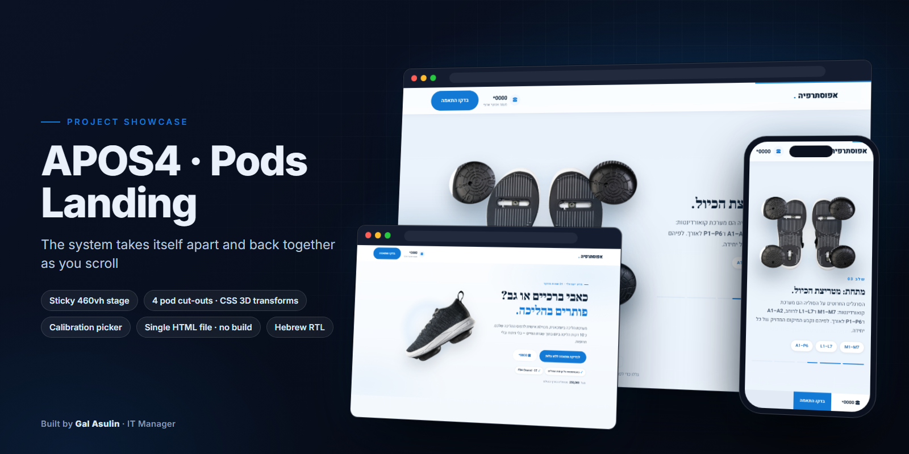
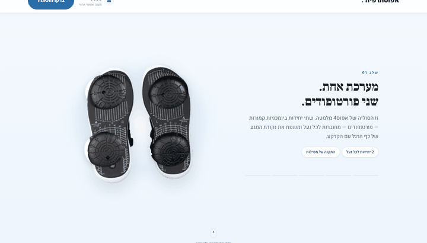
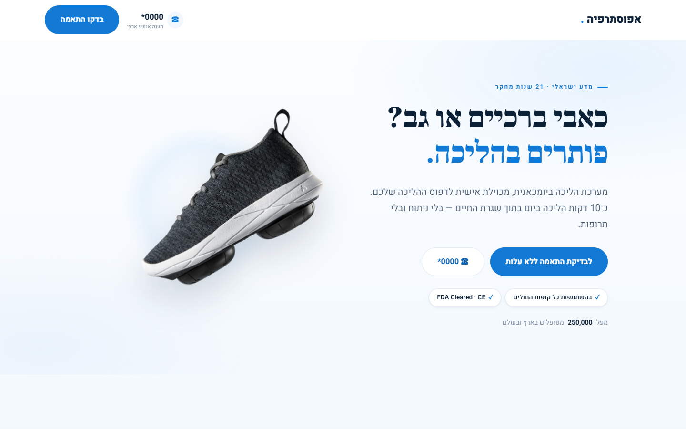
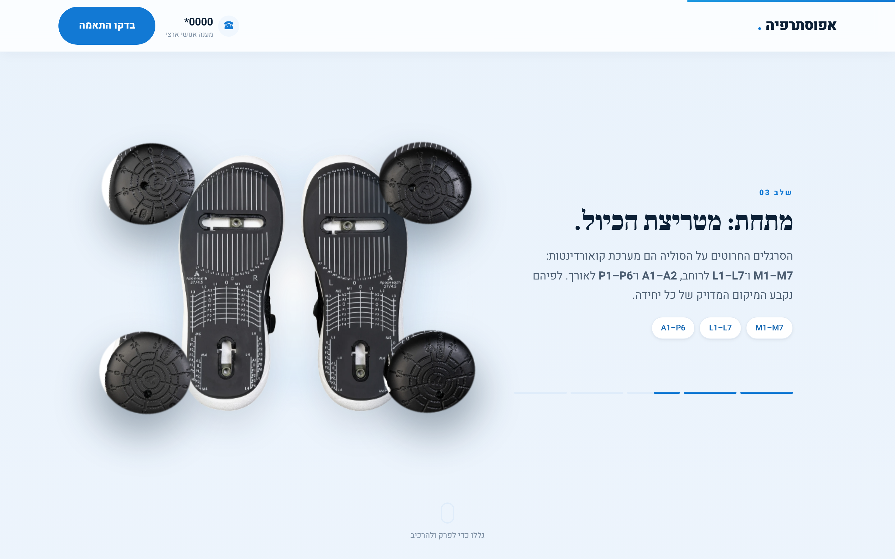
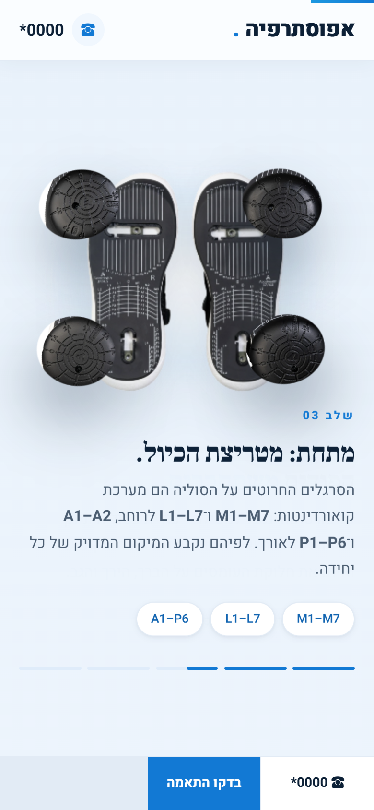
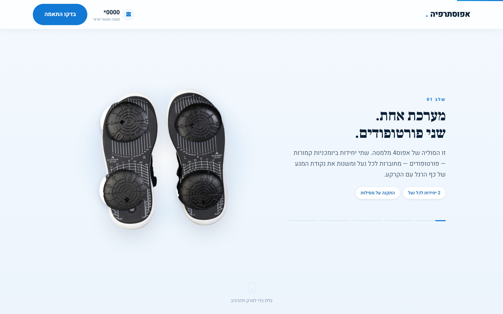
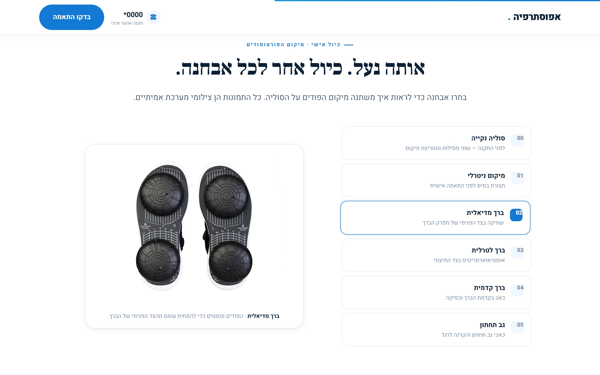
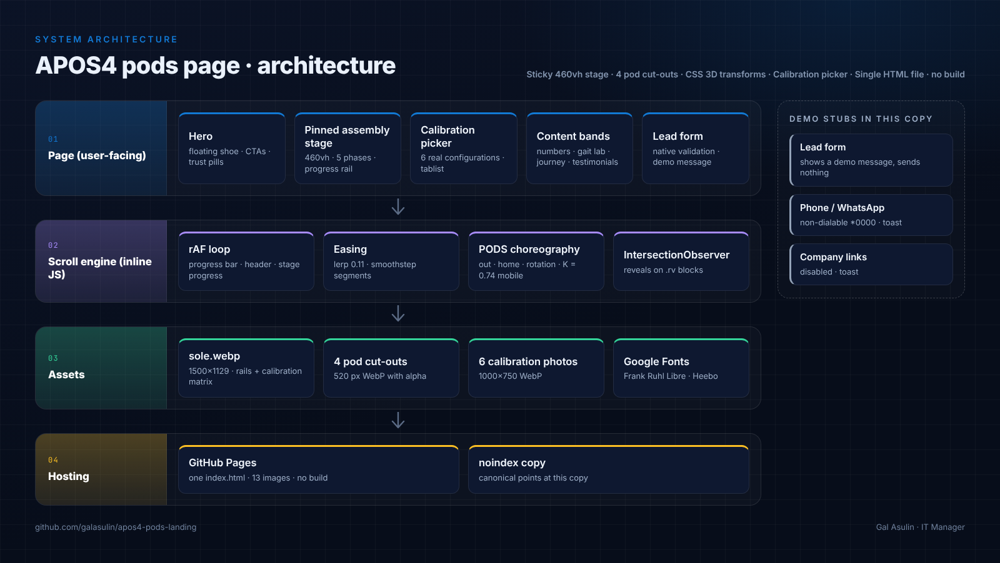
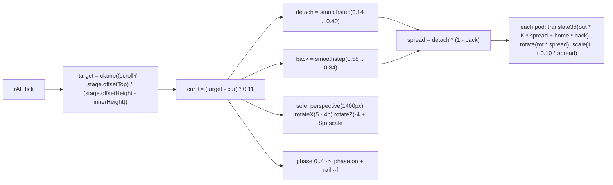

<p align="center"><a href="https://galasulin.github.io/apos4-pods-landing/"></a></p>

<div align="center">

# APOS4 · Pods Landing Page

**A product page where the APOS4 system takes itself apart and puts itself back together as you scroll, built from four real pod cut-outs and live CSS transforms.**

🇬🇧 English · 🇮🇱 [עברית](README.he.md)

[](https://galasulin.github.io/apos4-pods-landing/)


<br>


[Live demo](https://galasulin.github.io/apos4-pods-landing/) · [Screens](#screens) · [Architecture](#architecture) · [Tech](#technical-parameters)

<br>

<a href="https://galasulin.github.io/apos4-pods-landing/"></a>

<sub>On the live page, scroll through the pinned stage to take the system apart and back together.</sub>

</div>

> **Portfolio copy.** A sanitized, static copy of a landing page I designed and built for the clinic network. Tracking was never added to this version; the lead form only shows a demo message, phone and WhatsApp numbers are replaced with a non-dialable `*0000`, links to the company site are disabled, and patient names in the testimonials are replaced with invented names.

## At a glance

| | |
|---|---|
| **Type** | Product landing page with a scroll-driven assembly animation |
| **Status** | Working version built for the APOS4 launch · this repo is the sanitized copy |
| **Stack** | HTML5 · CSS (sticky, 3D transforms, custom properties) · vanilla JavaScript |
| **My role** | Concept, image preparation, design, front-end engineering |
| **Live demo** | [galasulin.github.io/apos4-pods-landing](https://galasulin.github.io/apos4-pods-landing/) |
| **Languages** | UI in Hebrew (RTL) · docs in English and Hebrew |

## Screens

<table>
  <tr>
    <td width="33%"><a href="docs/desktop-hero.png"></a><br><sub><b>Hero</b> · floating shoe, CTA, trust pills</sub></td>
    <td width="33%"><a href="docs/stage-apart.png"></a><br><sub><b>Stage · apart</b> · phase 03, pods fully off, rails and calibration matrix exposed</sub></td>
    <td width="33%" align="center"><a href="docs/mobile-stage.png"></a><br><sub><b>Mobile</b> · sole above, phase text below</sub></td>
  </tr>
  <tr>
    <td width="33%"><a href="docs/stage-whole.png"></a><br><sub><b>Stage · attached</b> · phase 01, all four pods on the sole</sub></td>
    <td width="33%"><a href="docs/calibration-picker.png"></a><br><sub><b>Calibration picker</b> · six real configurations, "medial knee" selected</sub></td>
    <td width="33%"></td>
  </tr>
</table>

## What it is

APOS4 is a walking system: two convex "pods" under each shoe that shift load away from a painful knee, hip or back. What makes it work is that the pods sit on rails and are **calibrated per patient**. A photo of the sole does not show that. Taking the system apart does.

So the centre of the page is a pinned stage. As you scroll, the four pods lift off the sole and float away, the engraved calibration matrix (M1–M7, L1–L7, A1–A2, P1–P6) shows underneath, and the pods return to a slightly different, personal position. The rest of the page carries the clinical numbers, an interactive calibration picker, the gait lab, pain areas, the treatment journey, testimonials and a lead form.

## Key capabilities

**Pinned assembly stage**
- `#stage` is `460vh` tall (`380vh` at ≤ 900 px) with a `position: sticky` panel of `100svh`.
- Five phases driven by scroll progress, each with its own copy, tags and a filling progress rail:

| Scroll progress | Phase | What you see |
|---|---|---|
| 0.00 – 0.14 | 01 | The system fully assembled |
| 0.14 – 0.42 | 02 | The pods detach and float away (motion runs 0.14 → 0.40) |
| 0.42 – 0.58 | 03 | Fully apart: rails and the calibration matrix are visible |
| 0.58 – 0.86 | 04 | The pods return to a personal position (motion runs 0.58 → 0.84) |
| 0.86 – 1.00 | 05 | Locked: "now you just walk" |

- The marketing idea in one motion: **every system is calibrated for one person.**

**Real product imagery, not a 3D model**
- The four pods were cut from the original product photo along an ellipse with feathered edges, so putting them back on the sole reproduces the original photo exactly.
- Each pod is positioned in percent of the 1500 × 1129 sole image (`#pod-rf` at `left 19.848% / top 15.765%`, and so on), so the overlay stays aligned at any width.
- A `PODS` array holds each pod's `out` vector, `home` offset and rotation; a `K` factor (0.74 below 900 px) shrinks the spread on mobile.

**Calibration picker**
- Six real photos of the system: clean sole, neutral, medial knee, lateral knee, anterior knee, lower back.
- Built as `role="tablist"` with `role="tab"` buttons and `aria-selected`; images cross-fade (`opacity`, 0.5 s) and the caption updates.
- The six configuration images are normalised to the same content height, so switching between them does not jump.

**Page furniture**
- Scroll progress bar (3 px) across the top, sticky blurred header (`backdrop-filter`), floating hero shoe (7 s loop).
- Marquee of health funds and approvals (38 s linear loop, list duplicated for a seamless wrap).
- `IntersectionObserver` reveals on every `.rv` block.
- Lead form with native constraint validation (`required`, `checkValidity()`, `reportValidity()`), region select and consent; a valid submit shows a demo message.
- Fixed bottom action bar (call / check) on screens ≤ 860 px, with safe-area padding.

**Reduced motion**
- `prefers-reduced-motion` disables smooth scrolling, the hero float, the marquee and the reveal transitions, and leaves the pods on the sole: the phase text still advances with scroll, but nothing moves.

## Architecture



Everything lives in one `index.html`: tokens and layout in an inline `<style>`, the engine in an inline `<script>`, and a second tiny script for demo toasts. A single `requestAnimationFrame` loop runs for the life of the page. Each tick it updates the top progress bar and header state, computes progress through `#stage` from `scrollY` and `offsetTop`, eases it, and derives two smoothstep curves: one for detaching and one for returning. Their product is the current "spread", which is turned into a `perspective / rotateX / rotateZ / translate3d / rotate / scale` transform and a matching drop-shadow for each pod. The sole gets a slow tilt and breathing scale from the same progress, and the phase index switches the visible copy and fills the rail.

### Flow



## Technical parameters

| Parameter | Value |
|---|---|
| Page shell | one `index.html`, 50,648 B: inline CSS, inline engine, inline demo-toast script |
| Images (`assets/`) | 13 WebP · 892 KB total |
| Sole | `sole.webp` 1500 × 1129 · with alpha · 144,086 B |
| Pod cut-outs | 4 WebP, 520 px wide (446 to 462 px high) · with alpha · 36,850 to 47,694 B each |
| Calibration photos | 6 WebP · 1000 × 750 · 43,600 to 52,226 B each |
| Other photos | `hero-shoe.webp` 1200 × 961 (168,732 B) · `walk.webp` 1400 × 933 (105,908 B) |
| First-party page weight | 932,496 B (about 911 KiB): HTML plus all 13 images; fonts not counted |
| Stage | `460vh` (`380vh` at ≤ 900 px) · sticky panel `min-height: 100svh` · rig aspect ratio 1500 / 1129 |
| Phases | 5 · boundaries 0.14 / 0.42 / 0.58 / 0.86 |
| Easing | lerp 0.11 per frame (1.0 under reduced motion) · smoothstep `t²(3 − 2t)` per segment |
| Pod motion | out vectors ±19% × ±11.5–12% of the rig box · home offsets ±1.6–1.8% × ±3.0–3.2% · rotation ±12–14° · lift scale up to 1.10 · shadow 6 → 32 px offset |
| Sole motion | `perspective(1400px)` · rotateX 5° → 1° · rotateZ −4° → +4° · scale 0.965 to 1.015 (sine) |
| Mobile spread factor | `K = 0.74` below 900 px |
| Reveal observer | threshold 0.12 · `rootMargin: 0px 0px -8% 0px` |
| Breakpoints | 420 · 520 · 600 · 640 · 860 · 900 · 940 · 1000 · 1500 px |
| Fonts | Frank Ruhl Libre 500 / 700 / 900 (display) · Heebo 300 to 900 (body) · Google Fonts with `display=swap` |
| External hosts | `fonts.googleapis.com`, `fonts.gstatic.com` only |
| Dependencies / build | none / none |
| Preview GIF | `docs/apos4-pods.gif` · 29 frames · 720 × 450, full frame with the header |

## Engineering decisions

- **Cut-outs from the real photo, not a 3D render** → the assembled state is pixel-identical to the product photo, and only five images (sole + four pods) are needed for the whole animation. Trade-off: the camera cannot turn; motion is limited to 2D transforms with a light perspective tilt.
- **Percent-based pod placement** → pod boxes are defined in percent of the sole image, and offsets in percent of the rig, so the same choreography fits a 430 px phone and a 760 px desktop rig.
- **Two smoothstep segments multiplied into one `spread`** → detaching and returning are tuned independently, and the "fully apart" hold (0.42–0.58) falls out of the gap between them with no extra state.
- **`home` offsets on return** → the pods come back slightly off their original spot, which is exactly the clinical message: the final position is personal.
- **A continuous rAF loop** → simple and always in sync with the progress bar and header. Trade-off: it keeps running while the page is idle; the later frame-sequence version, [apos4-scroll-landing](https://github.com/galasulin/apos4-scroll-landing), stops its loop when nothing moves.
- **Native form validation** → `required` fields and `reportValidity()` give accessible, localised browser messages with no extra script.

This is the earlier, transform-based version of the idea. The later frame-sequence version is [apos4-scroll-landing](https://github.com/galasulin/apos4-scroll-landing).

## Status and my role

A working version made for the APOS4 launch. This repository is the sanitized portfolio copy.

I designed and built the page end to end: the concept of showing calibration as a take-apart animation, cutting and normalising the product images (WebP assets processed with Python / Pillow), the layout, the scroll engine and the RTL copy layout.

## Repository layout

```
apos4-pods-landing/
├── index.html            the whole page: inline CSS, scroll engine, demo toast
├── assets/
│   ├── sole.webp         sole with rails and calibration matrix
│   ├── pod-rf/rh/lf/lh   four pod cut-outs
│   ├── cfg-*.webp        six calibration configurations
│   ├── hero-shoe.webp
│   └── walk.webp
├── docs/                 README screenshots and the animated preview
└── LICENSE
```

## Privacy & scope

| Item | In this copy |
|---|---|
| Tracking / tag manager | Never added to this version |
| Lead form | Validates, then shows a demo message; nothing is sent |
| Phone and WhatsApp numbers | Replaced with a non-dialable `*0000` that shows a demo toast |
| Links to the company site | Disabled (`data-demo`), they show a demo toast |
| Patient names in testimonials | Replaced with invented names |
| Search | Page marked `noindex`; canonical points at this GitHub Pages copy |

AposTherapy and APOS names, logos and product photos belong to their owner and are shown for portfolio purposes. See [LICENSE](LICENSE).

---

<div align="center"><b>Built by <a href="https://github.com/galasulin">Gal Asulin</a>, IT Manager</b></div>

<div align="center"><sub>Landing pages in this portfolio: <a href="https://github.com/galasulin/apos4-scroll-landing">apos4-scroll-landing</a> · <a href="https://github.com/galasulin/apos4-pods-landing">apos4-pods-landing</a> · <a href="https://github.com/galasulin/apostherapy-research-landing">apostherapy-research-landing</a></sub></div>
